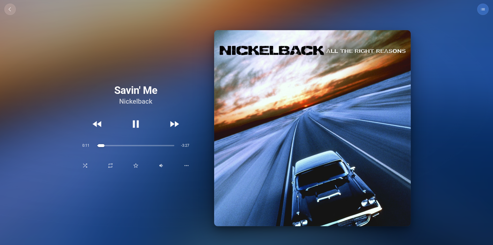

# YTM Now Playing

A clean, full-screen **Now Playing** view for [YouTube Music](https://music.youtube.com), inspired by
the Apple Music / CarPlay player: large cover art on the right, track info and pill-shaped controls on
the left, a thin progress bar with negative remaining time, and a blurred ambient background taken
from the current cover that cross-fades on every track change.

It is a plain Manifest V3 browser extension: no build step, no dependencies, no data collection, no
network requests of its own.

## Features

- Title and artist
- Previous / play-pause / next, seek by clicking or dragging the progress bar
- Shuffle, repeat (off / all / one), like (★)
- **More (`…`)**: the track's native menu (play next, add to queue, save to playlist, go to artist…)
  rendered in a frosted-glass popover
- **Queue**: side panel with the current queue; click a song to play it
- **Volume**: speaker icon next to the star; hover to show the slider, click to mute,
  scroll over it to adjust
- Works with both the old (`ytmusic-player-bar`) and the new (`ytmusic-miniplayer`) YouTube Music UI
- UI labels in English, or Portuguese when the browser language is Portuguese

## Install (unpacked, no Web Store)

Works in any Chromium-based browser (Chrome, Edge, Brave, Opera, Vivaldi).

1. Clone or download this repository.
2. Open `chrome://extensions` (or `edge://extensions`, `brave://extensions`).
3. Enable **Developer mode**.
4. Click **Load unpacked** and select the project folder.
5. Open or reload `https://music.youtube.com`.

After editing the code, click ↻ on the extension card and reload the YouTube Music tab.

## Usage

| Action | How |
| --- | --- |
| Open / close | New expand button in the YTM player bar, the **C** key, or the extension's toolbar icon |
| Close | **Esc** or the `‹` button |
| Queue | Queue icon (top right) or **Q** |
| Volume | **↑ / ↓**, mouse wheel over the speaker icon |
| Like | ★ button (uses YouTube Music's own `+` shortcut) |

## How it works

| File | Role |
| --- | --- |
| `manifest.json` | MV3 manifest; scripts only run on `music.youtube.com` |
| `content.js` | Builds the overlay (isolated world) and drives YouTube Music's own controls |
| `main.js` | Runs in the page's main world to use the internal player API (volume, mute), close native menus and read queue thumbnails |
| `styles.css` | The whole look: ambient blur, glass panels, layout |
| `background.js` | Toggles the view when the toolbar icon is clicked |

Track metadata comes from `navigator.mediaSession` with a DOM fallback, and playback state from the
page's `<video>` element. YouTube Music enforces Trusted Types, so the UI is built with
`createElement` only (no `innerHTML`).

YouTube Music changes its markup from time to time; if a control stops working, the selectors live
in the `SEL` object at the top of `content.js`.

## License

[MIT](LICENSE)

## Disclaimer

Unofficial project, not affiliated with or endorsed by YouTube or Google.
